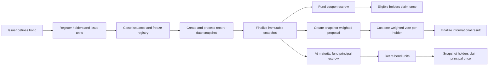
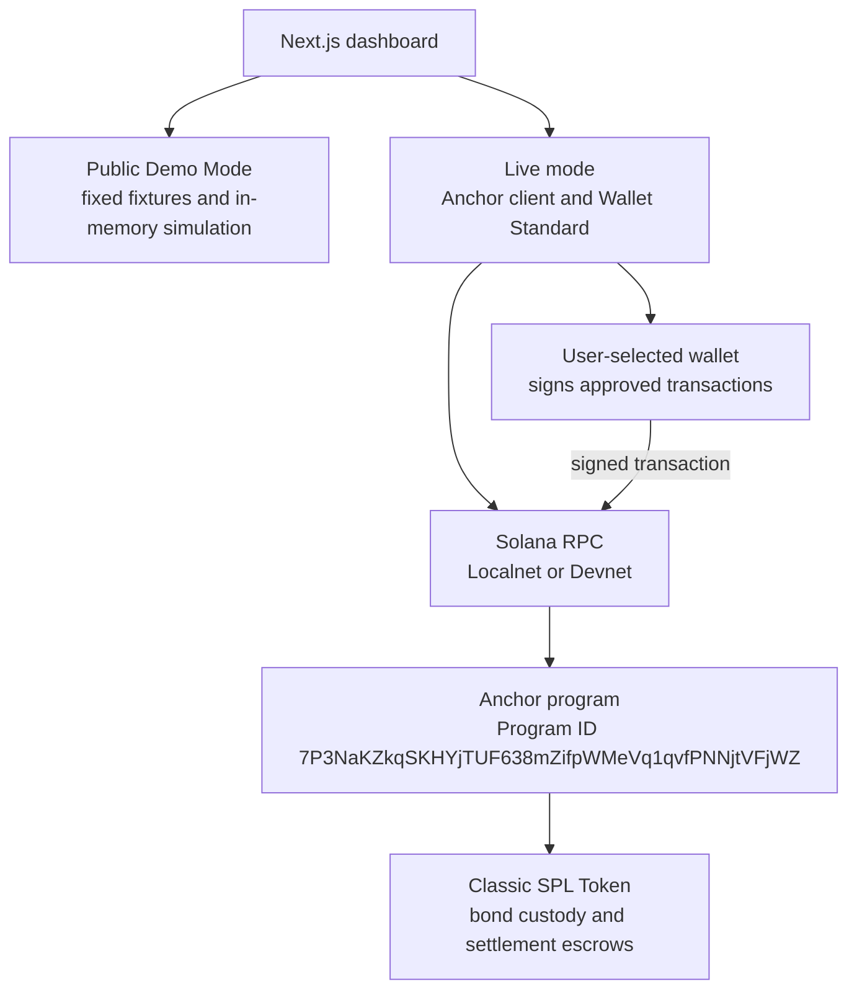

# KASE Treasury

<p align="center">
  <strong>Inspectable bond lifecycle and corporate actions on Solana</strong>
  <br />
  An independent educational prototype for making bondholder eligibility, coupon entitlements, redemption, and voting easier to follow.
</p>

<p align="center">
  <a href="https://solana.com"></a>
  <a href="https://www.anchor-lang.com/"></a>
  <a href="https://www.rust-lang.org/"></a>
  <a href="https://nextjs.org/"></a>
  <a href="https://www.typescriptlang.org/"></a>
  
</p>

> **Important:** KASE Treasury is an independent educational prototype prepared in the context of the Superteam Kazakhstan × KASE Corporate Actions on Blockchain challenge. It is not an official KASE product and is not affiliated with, endorsed by, or approved by KASE. The Anchor program has been tested on a local validator, but has **not** been deployed to Solana Devnet or Mainnet. The public browser walkthrough is a deterministic simulation and does not submit blockchain transactions.

## Quick links

| Resource | Link |
| --- | --- |
| Live website | [kase-treasury.vercel.app](https://kase-treasury.vercel.app/) |
| Interactive public demo | [Five-step lifecycle walkthrough](https://kase-treasury.vercel.app/operations) |
| Video presentation | [Watch on YouTube](https://youtu.be/v8jqhUdDU5U) |
| Source code | [Eunoia-SSS/kase-treasury](https://github.com/Eunoia-SSS/kase-treasury) |

## Project screenshot

> **Screenshot placeholder:** This repository does not yet contain an authentic website screenshot. Add browser captures of the live dashboard and interactive demo under `docs/images/` to replace this note. No stock or generated image is used.

## Hackathon submission

| | |
| --- | --- |
| Project | **KASE Treasury** |
| Challenge context | Superteam Kazakhstan × KASE — Corporate Actions on Blockchain |
| Project type | Independent educational Solana prototype |
| KASE relationship | None; the project is not official, affiliated, endorsed, or approved by KASE |

KASE Treasury explores how a bond lifecycle can be represented with explicit on-chain state and a judge-friendly browser demonstration. It is a prototype and does not replace regulated market infrastructure.

## Problem and solution

Bond corporate actions depend on a shared, verifiable answer to three questions: who was eligible on the record date, how much each holder is entitled to, and whether each payment or vote has already been processed. If eligibility, calculations, funding, and evidence are split across systems, reconciliation becomes difficult to inspect.

KASE Treasury models those steps around a finalized holder snapshot. The Anchor program records beneficial positions, freezes a closed bond registry for snapshot processing, and binds coupon claims, principal claims, and governance votes to immutable snapshot entries. Unique per-holder receipts prevent replay in the tested local program. A separate public simulation lets reviewers follow the same lifecycle without a wallet or network connection.

## Why Solana?

Solana provides program-owned accounts, signer authorization, SPL Token interfaces, and transactions whose program state and token operations can be inspected together. Those capabilities let this prototype make eligibility, reserves, claims, votes, and lifecycle transitions explicit in a single program model.

This is a practical prototype choice, not a claim that Solana replaces legal, regulated, or operational market infrastructure.

## Key features

**Implemented and exercised by the Anchor program on a local validator:**

- Issuer-controlled bond setup and whole-unit issuance.
- Program-controlled SPL bond-token custody with PDA-based beneficial-holder positions.
- A sequential, 100-holder registry and bounded record-date snapshot processing.
- Fully reserved coupon periods with integer base-unit calculations and one claim receipt per holder.
- Maturity redemption with separate principal escrow, full bond-token retirement, and one redemption receipt per holder.
- Snapshot-weighted Yes / No / Abstain voting with one vote receipt per holder and informational results.

**Available as a separate public browser simulation:**

- A deterministic five-step example that can be replayed and reset.
- Sample balances and action states that update in the browser without wallet access or RPC.

The hosted dashboard also contains illustrative portfolio fixtures. Dashboard values and public demo results are not live issuer, investor, settlement, or Solana account data.

## Corporate actions lifecycle

The program models the following lifecycle. The website's public walkthrough simulates it rather than submitting transactions.



A snapshot is forward-dated and can be processed only at or after its cutoff using Solana's on-chain clock. The program does not reconstruct arbitrary historical SPL balances. Issuance must be closed before snapshot creation; the MVP has no holder transfer instruction.

## Technology stack

| Layer | Technologies |
| --- | --- |
| Web application | Next.js 15, React 19, TypeScript, Tailwind CSS 4 |
| Program | Rust, Anchor 0.31.1 |
| Solana assets | Solana 2.1.0 toolchain, classic SPL Token |
| Wallet integration | Wallet Standard discovery and wallet-approved signing in live mode |
| Verification | Rust unit tests, Anchor local-validator tests, TypeScript demo tests, ESLint |

## System architecture

The application has distinct simulation and live-client paths. The public Demo Mode uses fixed sample data and a local in-memory state machine. Live mode can read configured Localnet or Devnet accounts and prepare wallet-signed operations; it does not use browser-held issuer or investor key files. The program is not currently deployed to Devnet.



**On-chain ownership model:** zero-decimal bond units remain in a PDA-authorized token vault. Program-owned Position accounts represent beneficial ownership, while sequential RegistryEntry accounts enable bounded enumeration. Investors do not hold or directly transfer bond SPL tokens in this MVP. Coupon, redemption, and governance rights use a finalized snapshot rather than current wallet token balances.

See [ARCHITECTURE.md](./ARCHITECTURE.md) and [PROTOCOL_SPEC.md](./PROTOCOL_SPEC.md) for account and instruction details.

## Interactive demo walkthrough

Open the [public lifecycle demo](https://kase-treasury.vercel.app/operations). It requires no wallet, validator, RPC endpoint, or SOL. The page labels the actions as simulated; it does not create Solana signatures or Explorer links.

| Step | Simulated action | Expected example |
| ---: | --- | --- |
| 1 | Issue 17 bond units | A: 10 · B: 5 · C: 2 |
| 2 | Finalize the record-date snapshot | Eligible voting and payment units: 10 / 5 / 2 |
| 3 | Fund and claim coupons | 500 / 250 / 100 DSET; 850 DSET total |
| 4 | Vote and finalize the proposal | Voting weights 10 / 5 / 2 |
| 5 | Redeem principal | 10,000 / 5,000 / 2,000 DSET; 17,000 DSET total; final supply 0 |

DSET is fabricated demonstration data with no monetary value, price, or KZT peg. These figures describe the browser simulation. They are not real funds or Devnet transactions.

## Quick start

### Public Demo Mode

Requirements: Node.js/npm as listed by the project toolchain. The following starts the frontend in its default public simulation mode.

```bash
git clone https://github.com/Eunoia-SSS/kase-treasury.git
cd kase-treasury
npm ci
npm run dev
```

Open [http://localhost:3000](http://localhost:3000). The default mode needs no wallet, RPC URL, Solana validator, or SOL.

### Live Localnet interface

Live mode is separate and requires the Solana/Anchor toolchain, a running local validator, the program deployed to that validator, and a compatible wallet configured for Localnet. Follow [DEVNET_RUNBOOK.md](./DEVNET_RUNBOOK.md) for the existing setup and transaction sequence. Set `NEXT_PUBLIC_APP_MODE=live` in an untracked `.env.local` only when you intend to use live mode.

**Devnet status:** The client supports Devnet configuration, but KASE Treasury has not been deployed there. Selecting Devnet does not imply the program is available or that transactions have been made.

## Testing and verification

The following project results are recorded in the latest implementation review for commit `44af5ff`. This README-only change does not alter application or program code, and those checks were not rerun for this documentation update.

| Check | Recorded result |
| --- | --- |
| `npm run typecheck` | Passed |
| `./node_modules/.bin/eslint src` | Passed |
| `npm run typecheck:tests` | Passed |
| `npm run test` | Passed; 9 deterministic Demo Mode tests |
| `npm run build` | Passed; Next.js production build |
| `cargo fmt --all -- --check` | Passed |
| `cargo test -p kase_treasury -q` | Passed; 5 Rust tests |
| `anchor build` | Passed |
| `npm run test:anchor` | Passed; 22 local-validator integration tests |

To run the frontend checks:

```bash
npm run typecheck
./node_modules/.bin/eslint src
npm run typecheck:tests
npm run test
npm run build
```

For the local validator suite, use the documented Anchor/Solana toolchain and follow [DEVNET_RUNBOOK.md](./DEVNET_RUNBOOK.md). A passing local test suite is not an independent security audit and does not establish Devnet deployment.

## Security and limitations

- **Prototype only:** no independent security audit, production-readiness claim, or regulatory-compliance claim.
- **No Devnet deployment:** the program has not been deployed to Devnet or Mainnet, and no Devnet transaction is claimed.
- **Simulation boundary:** public browser demo and dashboard fixtures are illustrative; the demo makes no RPC calls, asks for no wallet, and produces no real signatures.
- **Custodial ownership model:** bond tokens stay in a program-controlled vault; beneficial positions are not freely transferable bond tokens in investor wallets.
- **Bounded scale:** the on-chain holder registry supports up to 100 holders; frontend history is a bounded signature scan and is not a complete indexer.
- **Locked residual balances:** there is no recovery or sweep instruction for unclaimed coupon or principal escrow funds.
- **Operational dependencies:** browser-wallet Localnet transaction signing still needs an end-to-end wallet smoke test. The configured settlement mint's freeze authority can halt escrow or holder accounts; the demo mint must not retain one.
- **External risks:** no legal enforceability, KYC/AML, regulated custody, fiat settlement, investment advice, or relationship with KASE is represented.
- **Dependency status:** the latest documented production dependency audit reported 17 advisories (6 high, 11 moderate); compatible fixes were not applied in that review. Reassess dependencies before any broader use.

More detail is in [SECURITY_MODEL.md](./SECURITY_MODEL.md).

## Roadmap

| Status | Milestones |
| --- | --- |
| **Completed locally** | M2 bond issuance and registry · M3 immutable snapshots · M4 coupon settlement · M5 principal redemption · M6 informational weighted governance · M9B public deterministic simulation |
| **Prepared / validation remains** | M9A live frontend reads and wallet-signed flows; browser-wallet Localnet transaction smoke test remains |
| **Planned** | M8 Devnet deployment and end-to-end Devnet demonstration, subject to approved disposable wallets and funding · complete transaction indexing · any later security review needed for broader use |

“Completed locally” means exercised against the local validator and/or local test environment as documented. It does not mean deployed to Devnet. The roadmap sequence and acceptance gates are maintained in [MASTER_PLAN.md](./MASTER_PLAN.md).

## Documentation and resources

- [Product specification](./PRODUCT_SPEC.md)
- [Protocol specification](./PROTOCOL_SPEC.md)
- [Security model and review notes](./SECURITY_MODEL.md)
- [System architecture](./ARCHITECTURE.md)
- [Development roadmap](./MASTER_PLAN.md)
- [Devnet runbook](./DEVNET_RUNBOOK.md)
- [Hackathon submission copy and status](./SUBMISSION.md)
- [Two-minute demo video script](./DEMO_VIDEO_SCRIPT.md)
- [Submission checklist](./SUBMISSION_CHECKLIST.md)
- [README presentation reference](https://github.com/Marakaya/colosseum_example)

---
<p align="center">
  KASE Treasury · Independent educational prototype · No official KASE affiliation
</p>
